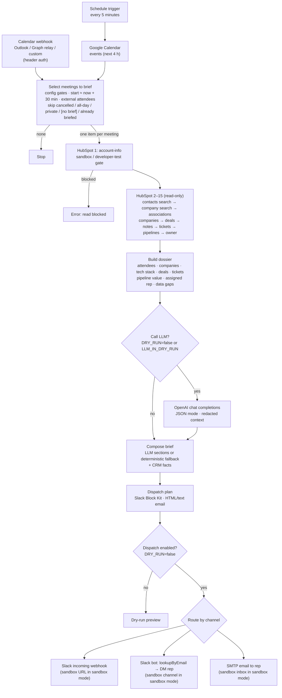

# n8n-hubspot-meeting-agenda-pre-brief-generator

Time-triggered pre-meeting intelligence for **n8n** and **Node.js**. Every few minutes it finds calendar meetings starting in about **30 minutes** that include **external attendees**. For each one it pulls the attendees' contacts, companies, open and recent deals, deal notes, and open tickets from **HubSpot**, has an **LLM** compile a scannable executive pre-brief, and sends it to the **assigned account executive** over **Slack** (Block Kit) or **email** (HTML and plain text).

I built it fail-safe. On import, **`DRY_RUN=true` and `SANDBOX_MODE=true`**:

- Nothing is sent to Slack or email, and no LLM call is made.
- HubSpot is only read after the portal is verified as a sandbox or developer test account.
- Production data and real reps need a third, explicit opt-in.

---

## Contents

- [What a pre-brief looks like](#what-a-pre-brief-looks-like)
- [Architecture](#architecture)
- [Repository layout](#repository-layout)
- [Meeting selection](#meeting-selection)
- [HubSpot enrichment](#hubspot-enrichment)
- [HubSpot custom property schema](#hubspot-custom-property-schema)
- [LLM briefing](#llm-briefing)
- [Dispatch](#dispatch)
- [Setup guide](#setup-guide)
- [Safety gates and modes](#safety-gates-and-modes)
- [Environment variables](#environment-variables)
- [Edge-case handling](#edge-case-handling)
- [Testing and the security scan](#testing-and-the-security-scan)
- [Disclaimer & Limitation of Liability](#️-disclaimer--limitation-of-liability)
- [License](#license)
- [Author](#author)

---

## What a pre-brief looks like

```text
[SANDBOX] Pre-brief: Platform Review: Example Org x Example Co
Mon, Nov 16, 15:00 UTC · starts in ~30 min · Join link

Attendees                                         Pipeline
Priya Shah, VP Revenue Operations, Example Org    1 open deal · $48,000
  (last contacted Nov 2, 2026)                    Open tickets: 1
Lee Wong (not in CRM yet)

Attendee background
• Priya Shah, VP Revenue Operations; 7 logged touches, last contacted Nov 2.
• Lee Wong is not in CRM yet.
Company context
• Example Org: 850-person analytics software company in Austin.
• Stack: HubSpot, Snowflake, Segment, Zendesk; evaluating reverse-ETL in Q1.
Open deals & pipeline
• Platform Expansion is at Decision Maker Bought-In, closing Dec 15.
Potential pain points
• Manual lead routing and duplicate records.
• Open high-priority ticket on webhook sync delays.
Suggested talking points
• Close out SSO/SCIM questions to finish the security review.
• Offer a multi-year option, as procurement requested.

LLM summary of HubSpot data. Verify before quoting. · Would have gone to: jamie.cole@example.com
```

The header facts (time, attendees, pipeline value, ticket count) are computed directly from CRM data and **never pass through the LLM**, so figures are never hallucinated. The LLM writes only the five qualitative sections.

---

## Architecture



The same logic runs in two places:

| Runtime | Entry point | Use it for |
| --- | --- | --- |
| n8n | `workflow.json` | Scheduled production runs and calendar webhooks |
| Node.js | `src/index.js` | Local testing, offline dry runs, CI, or a small standalone service |

There is one source of truth. The config gates, meeting selection, HubSpot state machine, prompt builder, and formatters live in `src/` inside `// <n8n-core:…>` markers, and `scripts/build-workflow.js` embeds those exact regions into the n8n Code nodes. The tests fail if `workflow.json` drifts from `src/`, and they run the n8n Code nodes in a sandbox, including the full 15-stage HubSpot chain, to prove they produce the same dossier and the same Slack and email payloads as the Node modules.

---

## Repository layout

```text
n8n-hubspot-meeting-agenda-pre-brief-generator/
├── README.md                     This file
├── DISCLAIMER.md                 Full disclaimer and limitation of liability
├── LICENSE                       MIT
├── workflow.json                 Importable n8n workflow (generated from src/)
├── package.json                  Zero dependencies; node --test
├── .env.example                  Sanitized environment template
├── .gitignore
├── scripts/
│   └── build-workflow.js         Regenerates / checks workflow.json from src/
├── src/
│   ├── index.js                  Engine, HTTP/LLM/Slack/SMTP clients, calendar polling, CLI, webhook server
│   ├── calendar.js               Google / Outlook / webhook normalization and meeting selection
│   ├── hubspot-fetcher.js        Contact search, company associations, deal / note / ticket aggregation
│   ├── brief-formatter.js        LLM prompt builder, response parser, fallback brief, Block Kit / email / Markdown
│   └── config.js                 Fail-safe environment loader and read / dispatch gates
└── test/
    ├── workflow.test.js          54 tests incl. n8n parity and repository security scan
    └── fixtures/
        └── meeting-event-mock.json   Calendar events, recorded HubSpot responses, LLM response
```

---

## Meeting selection

A meeting is briefed when **all** of these hold:

| Check | Rule |
| --- | --- |
| Timing | Starts within `LEAD_MINUTES` ± half of `POLL_INTERVAL_MINUTES` (default 27.5–32.5 minutes from now) |
| Status | Not cancelled; not an all-day event |
| Privacy | Not marked private or confidential (`SKIP_PRIVATE_EVENTS=true`) |
| Opt-out | The title contains none of `IGNORE_TITLE_KEYWORDS` (default `[no brief]`, `[internal]`) |
| External attendees | At least one attendee who is not on an `INTERNAL_DOMAINS` domain, has not declined, and is not a room or resource calendar |
| Not yet briefed | Its key (`provider:eventId:start`) has not already been briefed |

Supported inputs:

- **Google Calendar** event resources (`start.dateTime`, `attendees[].responseStatus`, `resource`, `hangoutLink`).
- **Microsoft Graph / Outlook** events (`start.dateTime` plus `start.timeZone`). Local times are converted to UTC through IANA time zones, DST included. The standalone poller requests UTC with `Prefer: outlook.timezone="UTC"`.
- **Generic webhook** events (`event_id`, `title`, `start`, `attendees[].email`, `attendees[].response_status`).

If `INTERNAL_DOMAINS` is empty, the organizer's domain is treated as internal. A rescheduled meeting gets a new key, so it gets a fresh brief.

---

## HubSpot enrichment

The enrichment is a pure, serializable state machine with fifteen read-only stages. It runs identically in n8n (as Plan → Fetch? → Request node triples) and in Node:

| # | Stage | Endpoint | Skipped when |
| --- | --- | --- | --- |
| 1 | `account` | `GET /account-info/v3/details` | never (this is the read gate) |
| 2 | `contacts` | `POST /crm/v3/objects/contacts/search` (email `IN` attendees) | no external emails |
| 3 | `companySearch` | `POST /crm/v3/objects/companies/search` (domain `IN` attendee domains) | only consumer mailbox domains |
| 4 | `contactCompanies` | `POST /crm/v4/associations/contacts/companies/batch/read` | no contacts found |
| 5 | `companies` | `POST /crm/v3/objects/companies/batch/read` | no companies |
| 6 | `contactDeals` | `POST /crm/v4/associations/contacts/deals/batch/read` | no contacts |
| 7 | `companyDeals` | `POST /crm/v4/associations/companies/deals/batch/read` | no companies |
| 8 | `deals` | `POST /crm/v3/objects/deals/batch/read` | no deals |
| 9 | `dealNotes` | `POST /crm/v4/associations/deals/notes/batch/read` | no relevant deals |
| 10 | `notes` | `POST /crm/v3/objects/notes/batch/read` | no notes |
| 11 | `companyTickets` | `POST /crm/v4/associations/companies/tickets/batch/read` | no companies |
| 12 | `tickets` | `POST /crm/v3/objects/tickets/batch/read` | no tickets |
| 13 | `dealPipelines` | `GET /crm/v3/pipelines/deals` | no relevant deals |
| 14 | `ticketPipelines` | `GET /crm/v3/pipelines/tickets` | no open tickets |
| 15 | `owner` | `GET /crm/v3/owners/{ownerId}` | no owner on any record |

Aggregation rules:

- **Deals:** open deals first (by amount, then last modified), plus deals closed within `RECENT_DEAL_DAYS` (default 90) of the meeting. Capped at `MAX_DEALS`. Stage IDs are mapped to their pipeline labels.
- **Notes:** the newest `MAX_NOTES_PER_DEAL` per relevant deal, with HTML stripped and text truncated to 500 characters.
- **Tickets:** open tickets only (no `closed_date`), newest first, capped at `MAX_TICKETS`.
- **Pipeline value:** the sum of open deal amounts, computed in code. Mixed currencies and deals without an amount are flagged.
- **Assigned rep:** owner of the top open deal → company owner → contact owner → meeting organizer (if internal) → first internal attendee → `FALLBACK_RECIPIENT_EMAIL`.
- **Data gaps:** a failed stage (HTTP 429, 5xx, and so on) is recorded as, for example, `tickets:http_429`, and the brief still goes out with what is known. Only the account gate is fatal.

---

## HubSpot custom property schema

The engine reads standard HubSpot properties plus the custom **Company** properties named in `TECH_STACK_PROPERTIES`. I create these in the sandbox portal first. The internal names must match `TECH_STACK_PROPERTIES`.

| Object | Internal name | Label | Type / field type | Notes |
| --- | --- | --- | --- | --- |
| Company | `tech_stack` | Tech Stack | `enumeration` / `checkbox` | Multi-select options such as HubSpot, Snowflake, Segment. Stored as `A;B;C` and shown as `A, B, C`. |
| Company | `tech_stack_notes` | Tech Stack Notes | `string` / `textarea` | Free text, such as current evaluations or legacy systems. Truncated to 300 characters. |

Standard properties read (no setup needed):

| Object | Properties |
| --- | --- |
| Contact | `email`, `firstname`, `lastname`, `jobtitle`, `company`, `lifecyclestage`, `hs_lead_status`, `hubspot_owner_id`, `notes_last_contacted`, `notes_last_updated`, `num_contacted_notes`, `hs_last_sales_activity_timestamp`, `createdate` |
| Company | `name`, `domain`, `industry`, `numberofemployees`, `annualrevenue`, `lifecyclestage`, `hubspot_owner_id`, `city`, `country`, `description` |
| Deal | `dealname`, `dealstage`, `pipeline`, `amount`, `deal_currency_code`, `closedate`, `hs_lastmodifieddate`, `hubspot_owner_id`, `hs_is_closed`, `hs_is_closed_won`, `hs_next_step`, `createdate` |
| Note | `hs_note_body`, `hs_timestamp` |
| Ticket | `subject`, `hs_pipeline`, `hs_pipeline_stage`, `hs_ticket_priority`, `createdate`, `closed_date`, `hs_lastmodifieddate` |

I can add more tech-stack style properties by listing them in `TECH_STACK_PROPERTIES` (comma-separated internal names).

---

## LLM briefing

**Prompt assembly** (`buildLlmMessages`):

- A system prompt that demands JSON with exactly five keys (`attendee_background`, `company_context`, `open_deals`, `pain_points`, `talking_points`). It says to use only facts in the context, never invent names, numbers, or commitments, and write "Not recorded in CRM" when something is missing.
- The CRM context is wrapped in `<crm_context>` delimiters and labelled untrusted data. Any instructions inside it, such as a note saying "ignore previous instructions", are to be ignored. The fixture includes exactly that note.
- **Data minimization:** attendee emails are never sent. With `REDACT_PII_FOR_LLM=true`, email addresses and phone numbers inside free text (notes, descriptions, next steps) are replaced with `[email]` and `[phone]`. Dates and amounts are kept.
- The request uses `response_format: { type: "json_object" }`, `temperature` 0.2, and `max_tokens` 700, all configurable.

**Response handling** (`parseLlmResponse`):

- The response must be HTTP 200 with valid JSON (code fences are tolerated) and at least three populated sections.
- Each section is capped at 4 items of 240 characters, and control characters are stripped.
- Any failure (HTTP error, invalid JSON, missing sections, timeout) falls back to a **deterministic brief** built straight from CRM facts. The footer says which source was used.

I point `OPENAI_BASE_URL` at any OpenAI-compatible chat-completions endpoint and set `OPENAI_MODEL` to a model that supports JSON mode. The engine refuses to start in a mode that calls the LLM while the model is unset.

---

## Dispatch

| Channel | `DISPATCH_CHANNELS` / `SLACK_MODE` | Production target | Sandbox target |
| --- | --- | --- | --- |
| Slack incoming webhook | `slack` / `webhook` | `SLACK_WEBHOOK_URL` (a channel; the footer names the rep) | `SANDBOX_SLACK_WEBHOOK_URL` |
| Slack bot DM | `slack` / `bot` | `users.lookupByEmail` (rep) → `chat.postMessage` DM | `SANDBOX_SLACK_CHANNEL_ID` |
| Email | `email` | Assigned rep's email via SMTP | `SANDBOX_EMAIL_RECIPIENT` |

Formatting safeguards:

- **Slack:** all CRM and LLM text is escaped (`&`, `<`, `>`), so `<!channel>` or a crafted link inside a note can never ping a channel. Header text is capped at 150 characters and sections at 2,900; link unfurling is off. Join links are only rendered for `https://` URLs.
- **Email:** HTML-escaped, single-line subject (CR/LF stripped), `multipart/alternative` with a plain-text part. The standalone SMTP client uses implicit TLS or STARTTLS, refuses plaintext except on loopback, rejects header injection, and never logs credentials.
- **Sandbox:** sandbox sends are prefixed `[SANDBOX]` and state who would have received the brief.

---

## Setup guide

### 1. Prerequisites

- Node.js 18.18 or later (developed and tested on Node 22). Zero dependencies, so no `npm install` is needed.
- n8n 1.x.
- A **HubSpot developer test account or sandbox portal** with a private app holding these read scopes: `crm.objects.contacts.read`, `crm.objects.companies.read`, `crm.objects.deals.read`, `tickets`, `crm.objects.owners.read`, and `crm.schemas.deals.read` (for pipelines). Notes are read through their association with deals. If HubSpot returns a scope error for any stage, the response names the scope it wants, and the stage appears as a data gap.
- An LLM API key, a Slack incoming webhook or bot token, and/or SMTP credentials, each for a **test** destination first.

### 2. Run it offline first

```bash
npm test          # 54 tests, including the security scan
npm run dry-run   # replays the fixture calendar + recorded HubSpot responses; prints previews, sends nothing
```

`npm run dry-run` needs no credentials at all. When no HubSpot token is set, the CLI answers HubSpot calls from the recorded responses in `test/fixtures/meeting-event-mock.json`, and it only allows that in dry run.

### 3. Dry run against my sandbox portal

```bash
cp .env.example .env
# set HUBSPOT_SANDBOX_PRIVATE_APP_TOKEN, INTERNAL_DOMAINS, and a calendar token
node --env-file=.env src/index.js --poll
```

To preview the LLM output without sending anything, I also set `LLM_IN_DRY_RUN=true`, `OPENAI_MODEL`, and `OPENAI_API_KEY`.

### 4. Import the n8n workflow

1. In n8n, go to **Workflows → Import from File** and select `workflow.json`. It imports **inactive**.
2. Create credentials and select them on the matching nodes. Every node references a `REPLACE_WITH_…` ID until I do this:
   - **Google Calendar OAuth2** → *Google Calendar: Upcoming Events*
   - **Header Auth** → *Calendar Webhook*
   - **HubSpot App Token** (the *sandbox* private app) → every *HubSpot N: Request …* node
   - **OpenAI** → *OpenAI: Chat Completion*
   - **Slack API** (bot token) → *Slack: users.lookupByEmail* and *Slack: chat.postMessage*
   - **SMTP** → *Email: Send Brief (SMTP)*
3. Set n8n environment variables for the settings (see `.env.example`), including `SANDBOX_SLACK_WEBHOOK_URL` / `SLACK_WEBHOOK_URL` if I use incoming webhooks. If `$env` access is blocked in Code nodes (`N8N_BLOCK_ENV_ACCESS_IN_NODE=true`), the selection node falls back to the fail-safe defaults: dry run, sandbox.
4. Outlook users replace the Google Calendar request with a Microsoft Graph `calendarView` request, or post events to the **Calendar Webhook**. The selection node accepts Graph events (`value[]`), Google events (`items[]`), or `events[]`.
5. Activate the workflow. Dedupe state lives in workflow static data, which n8n persists **only for active (production) executions**. Manual test runs do not record briefed meetings.

### 5. Go live in stages

1. `DRY_RUN=true`, `SANDBOX_MODE=true`: review previews in the n8n execution log.
2. `DRY_RUN=false`, `SANDBOX_MODE=true`: real LLM calls and real sends, **to sandbox targets only**, from a verified sandbox portal.
3. `SANDBOX_MODE=false`, `ALLOW_PRODUCTION_MODE=true`: production data, real reps. Only after the steps in [DISCLAIMER.md](DISCLAIMER.md).

---

## Safety gates and modes

| `DRY_RUN` | `SANDBOX_MODE` | `ALLOW_PRODUCTION_MODE` | HubSpot reads | LLM | Dispatch |
| --- | --- | --- | --- | --- | --- |
| `true` *(default)* | `true` *(default)* | any | Sandbox / developer-test portal only (verified) | Off (opt-in `LLM_IN_DRY_RUN`) | Preview only |
| `false` | `true` | any | Sandbox portal only | On | Redirected to sandbox targets |
| any | `false` | `false` *(default)* | — | — | **Refuses to start** |
| `true` | `false` | `true` | Production portal | Off (opt-in) | Preview only |
| `false` | `false` | `true` | Production portal | On | Assigned rep |

More fail-safes:

- Only the literal string `false` disables `DRY_RUN`, `SANDBOX_MODE`, `LLM_ENABLED`, `REDACT_PII_FOR_LLM`, `SKIP_PRIVATE_EVENTS`, or `REQUIRE_WEBHOOK_SIGNATURE`. Typos, `0`, `no`, and empty values leave them **on**.
- Sandbox sends refuse to start without their sandbox targets, and any mode that calls the LLM or sends refuses placeholder secrets.
- Meetings are marked as briefed **before** dispatch (at-most-once), so a flaky channel never turns into a stream of duplicate briefs. Dry runs never consume a meeting.
- A test walks the workflow graph and fails if any Slack or email node can be reached without **Dispatch Enabled?**, if the LLM node can be reached without **Call LLM?**, or if any HubSpot data request can be reached without passing the account gate.

---

## Environment variables

| Variable | Default | Purpose |
| --- | --- | --- |
| `DRY_RUN` | `true` | No LLM call (unless opted in) and no dispatch |
| `SANDBOX_MODE` | `true` | Sandbox portal only; sandbox dispatch targets |
| `ALLOW_PRODUCTION_MODE` | `false` | Required for `SANDBOX_MODE=false` |
| `HUBSPOT_SANDBOX_PRIVATE_APP_TOKEN` / `HUBSPOT_PRIVATE_APP_TOKEN` | placeholder | Node engine tokens (sandbox mode reads only the sandbox one) |
| `HUBSPOT_SANDBOX_PORTAL_ID` | unset | Optional pin to one sandbox portal |
| `TECH_STACK_PROPERTIES` | `tech_stack,tech_stack_notes` | Custom company properties to include |
| `RECENT_DEAL_DAYS` / `MAX_COMPANIES` / `MAX_DEALS` / `MAX_NOTES_PER_DEAL` / `MAX_TICKETS` | `90` / `3` / `5` / `3` / `5` | Enrichment limits |
| `CURRENCY_CODE` | `USD` | Fallback currency for deals without one |
| `CALENDAR_PROVIDER` | `google` | `google`, `outlook`, or `webhook` (standalone polling) |
| `LEAD_MINUTES` / `POLL_INTERVAL_MINUTES` | `30` / `5` | Selection window |
| `INTERNAL_DOMAINS` | organizer domain | My company's email domains |
| `IGNORE_TITLE_KEYWORDS` | `[no brief],[internal]` | Title opt-outs |
| `SKIP_PRIVATE_EVENTS` | `true` | Never brief private or confidential events |
| `LLM_ENABLED` / `LLM_IN_DRY_RUN` | `true` / `false` | LLM switches |
| `OPENAI_API_KEY` / `OPENAI_BASE_URL` / `OPENAI_MODEL` | placeholder / OpenAI v1 / unset | LLM endpoint |
| `LLM_TEMPERATURE` / `LLM_MAX_TOKENS` | `0.2` / `700` | LLM tuning |
| `REDACT_PII_FOR_LLM` | `true` | Redact emails and phone numbers in free text |
| `DISPATCH_CHANNELS` / `SLACK_MODE` | `slack` / `webhook` | Channels |
| `SLACK_WEBHOOK_URL` / `SANDBOX_SLACK_WEBHOOK_URL` | placeholder | Incoming webhooks |
| `SLACK_BOT_TOKEN` / `SANDBOX_SLACK_CHANNEL_ID` | placeholder | Bot-mode DM and sandbox channel |
| `EMAIL_FROM` / `SANDBOX_EMAIL_RECIPIENT` / `FALLBACK_RECIPIENT_EMAIL` | placeholder | Email addressing |
| `SMTP_HOST` / `SMTP_PORT` / `SMTP_SECURE` / `SMTP_USER` / `SMTP_PASSWORD` | placeholder / `465` / `true` | Standalone SMTP |
| `BRIEF_TIMEZONE` | `UTC` | Time zone for displayed times |
| `GOOGLE_CALENDAR_ACCESS_TOKEN` / `GOOGLE_CALENDAR_ID` / `MS_GRAPH_ACCESS_TOKEN` | placeholder / `primary` | Standalone polling |
| `CALENDAR_WEBHOOK_SECRET` / `REQUIRE_WEBHOOK_SIGNATURE` | placeholder / `true` | HMAC-SHA256 `X-Signature` on the standalone webhook |
| `STATE_FILE` | unset (in memory) | Standalone dedupe state file |
| `HOST` / `PORT` | `127.0.0.1` / `8788` | Standalone server bind address |

---

## Edge-case handling

| Situation | What happens |
| --- | --- |
| Meeting seen by two consecutive polls | Same key, so it is briefed once (`already_briefed`) |
| Meeting rescheduled | New start time gives a new key, so a new brief goes out |
| Same event delivered twice in one batch | `duplicate_in_batch` skip |
| Only internal attendees, or external attendees all declined | `no_external_attendees` skip |
| Rooms and resource calendars | Ignored as attendees |
| Attendees on consumer mailbox domains | Looked up as contacts; their domain is never used to match a company |
| Attendee not in HubSpot | Listed as "not in CRM yet"; the talking points suggest qualifying them |
| No company matched | Brief still sent; `no_company_matched` gap |
| HubSpot 429 / 5xx on a stage | Node engine retries (honouring `Retry-After`); a final failure becomes a data gap and the brief still goes out |
| Portal is not a sandbox while `SANDBOX_MODE=true` | Run stops before any CRM data is read |
| Owner lookup fails or no owner exists | Rep falls back to the organizer, then an internal attendee, then `FALLBACK_RECIPIENT_EMAIL` |
| No recipient at all | Dispatch blocked with `no_recipient_resolved` (except sandbox targets) |
| Open deals in mixed currencies | Total marked approximate; gap recorded |
| LLM error, timeout, invalid JSON, or too few sections | Deterministic CRM brief is sent instead; the footer states why |
| Prompt injection inside a CRM note | Context delimited and labelled untrusted; output escaped before Slack and email |
| LLM output containing `<!channel>`, links, or HTML | Escaped in Slack and email |
| Outlook event in a local time zone | Converted via IANA zones; Windows zone names are rejected, not guessed |
| All-day, cancelled, private, or `[no brief]` events | Skipped with a reason |
| Slack user not found by email | Dispatch for that channel fails and is reported; other channels still send |
| n8n `$env` access blocked | Selection node falls back to dry run + sandbox |

---

## Testing and the security scan

```bash
npm test                 # node --test test/workflow.test.js
npm run check:workflow   # confirms workflow.json matches src/
npm run build:workflow   # regenerates workflow.json after editing src/
```

The suite (54 tests, zero dependencies) covers:

- **Config gates:** defaults, strict flags, the production opt-in, an LLM model required only when it will be called, sandbox target requirements, placeholder-secret refusal, the portal gate, and dispatch target resolution.
- **Calendar:** documented skip reasons for every fixture event, attendee classification, IANA and DST conversion, internal-domain fallback, dedupe and pruning, reschedules, private and invalid events.
- **HubSpot mock responses:** documented endpoints and filters, the full dossier from recorded responses, the account gate stopping after one call, failed stages as data gaps with rep fallback, consumer-domain handling, and enrichment limits.
- **LLM prompt assembly:** grounding and injection rules, delimited and redacted context, JSON-mode request, response parsing, every fallback path, and the deterministic brief.
- **Formatting:** Block Kit structure and limits, Slack escaping of `<!channel>`, HTML and subject safety, Markdown, and the dispatch plan.
- **Engine:** dry run with zero outbound calls, sandbox send with LLM and webhook redirect, dedupe across runs, LLM failure fallback, production Slack bot DM, missing-token errors, MIME header injection, an SMTP round-trip against a local relay, and HMAC verification.
- **n8n workflow:** in sync with `src/`, inactive on import, placeholder-only credentials, defaults with `$env` open and blocked, selection parity, the **entire 15-stage HubSpot chain executed node by node in a `vm` sandbox with output identical to `src/`**, compose parity on both LLM and fallback paths, and gate topology.
- **Security scan:** walks every file and fails on private key blocks, HubSpot tokens and legacy keys, OpenAI keys, Slack tokens and real webhook URLs, Google OAuth and API keys, AWS, GitHub, and Stripe keys, JWTs, hard-coded secret assignments, a committed `.env`, unsafe `.env.example` values, email addresses outside RFC 2606 domains (plus the author contact), and domains outside RFC 2606 or a short allowlist. The allowlist covers the author links, the HubSpot, OpenAI, Slack, Google, and Microsoft API hosts, and the consumer-mailbox list, and each entry carries a reason. The scan also tests itself against planted secrets and a planted foreign domain.

---

## ⚠️ Disclaimer & Limitation of Liability

**Use at your own risk.** The code, workflows, and scripts provided in this repository (`n8n-hubspot-meeting-agenda-pre-brief-generator`) are for educational and architectural demonstration purposes.

* **No Liability:** The author and dhRobin Systems assume no responsibility or liability for any direct, indirect, incidental, or consequential damages resulting from the use, misuse, or deployment of these scripts, including inaccurate LLM briefings, missed or misdirected notifications, and downstream commercial errors.
* **No Warranty:** All software, n8n JSON blueprints, and JavaScript modules are provided "AS IS" without warranty of any kind, express or implied, including but not limited to merchantability, fitness for a particular purpose, or non-infringement.
* **Production Testing Required:** Always test thoroughly in an isolated staging environment (for example a HubSpot developer test account or sandbox) with `SANDBOX_MODE=true` and `DRY_RUN=true` enabled before connecting live HubSpot credentials. Treat every brief as something that cannot be recalled once sent, and verify LLM output against the CRM before relying on it.
* **API Rate Limits & Quotas:** High-volume meeting syncs can exhaust HubSpot API rate limits, LLM provider quotas and budgets, and Slack or SMTP sending limits. Monitor usage and test load in a sandbox first.
* **Third-Party APIs & Compliance:** Users are solely responsible for complying with the terms of service, rate limits, data privacy regulations (GDPR, UK GDPR, CCPA/CPRA, PECR, and other regional laws), and security policies of HubSpot, the calendar provider, the LLM provider, Slack, and any connected services. That includes a lawful basis for processing meeting attendees' data, a data processing agreement and retention settings with the LLM provider, and limiting briefs to people with a legitimate need to see them.

The full disclaimer is also available in [DISCLAIMER.md](https://github.com/dhrobinsystems/n8n-hubspot-meeting-agenda-pre-brief-generator/blob/main/DISCLAIMER.md).

## License

Released under the MIT License. Copyright (c) 2026 DH Robin (dhRobin Systems). See [LICENSE](https://github.com/dhrobinsystems/n8n-hubspot-meeting-agenda-pre-brief-generator/blob/main/LICENSE).

## Author

- **Author:** DH Robin — Revenue Infrastructure Architect | HubSpot CRM Architecture | RevOps Automation | Outbound Systems
- **Website:** https://dhrobinsystems.com
- **Portfolio:** https://behance.net/dhrobinsystems
- **LinkedIn:** https://linkedin.com/in/dhrobin
- **Contact:** robin@dhrobinsystems.com

---

MIT © 2026 dhRobin Systems — Provided as-is, see the disclaimer.
